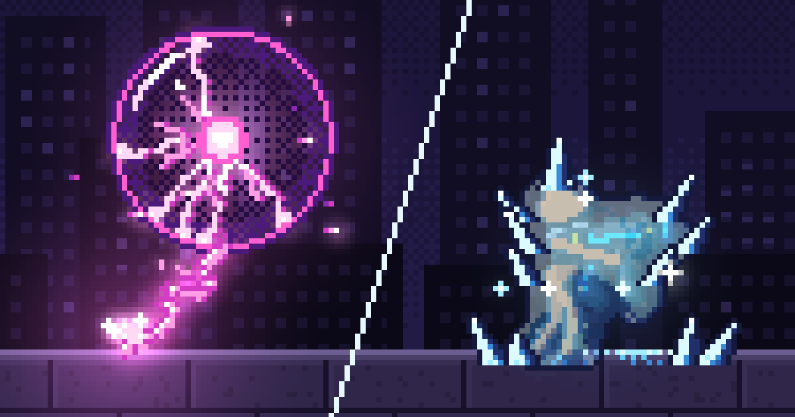
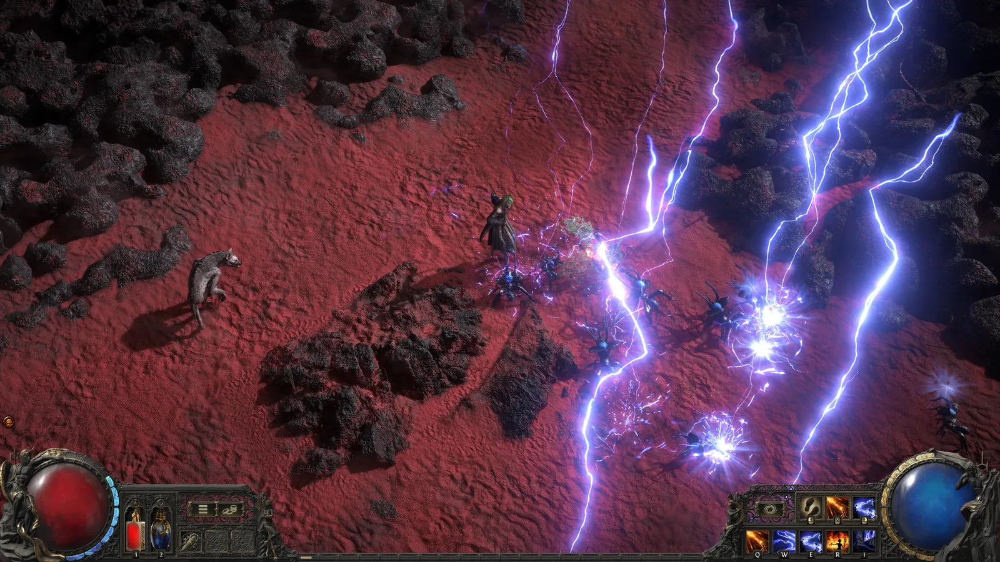

**원본 링크**: [How to make (good) pixel art effects with Claude](https://www.spritefusion.com/blog/how-to-make-good-pixel-art-effects-with-claude){:target="_blank"}{: target="_blank"}

본 기사는 픽셀 아트 효과를 만들 때 단발성 프롬프트만으로는 한계가 있음을 지적하며, 코드 활용, 디테일한 검토, 그리고 레퍼런스 활용이 결과물을 개선하는 핵심 요소임을 설명합니다.

## AI와 픽셀 아트 VFX의 한계

* AI가 픽셀 아트 VFX에서 **'원샷(one-shot)'으로 훌륭한 결과**를 얻기 어려움
* 만족스러운 결과물을 위해서는 과정에 **노력과 작업**을 투입해야 함

## 코드를 통한 효과 제작

* **코드의 유연성**으로 픽셀 아트 VFX 제작에 적합하며, 이미지 스프라이트의 경직성 한계 극복
* **추가 비용 절감**을 위해 `Claude Code`나 `Codex` 같은 코딩 에이전트만 활용 가능
* **아이디어의 초기화**를 위해 코드를 '찰흙'처럼 취급하고 느슨한 아이디어와 아트 디렉션 제공
* **초안 생성 및 검토**를 위해 에이전트가 5~10개의 초안을 작성하고 `/records` 디렉토리에 짧은 비디오로 렌더링
* **정교화 과정**으로 초안을 검토하고, 원하는 비전에 도달할 때까지 세부 사항을 다듬고 반복 작업 진행
* **자원 활용**을 위해 공개된 픽셀 아트 효과를 참고하여 에이전트가 수정 및 새로운 효과 구축 지원

## 디테일과 시각적 판단의 중요성

* 최종 품질 기준은 **제작자 스스로 설정**해야 함
* 만족스럽지 않은 결과에 타협하지 않고 **까다롭게 요구**하는 자세
* 특정 세부 사항 수정 및 모션 디자인을 맞추기 위한 **반복적인 상호작용**
* 시각적 요소와 모션이 완벽하게 느껴질 때까지 **조정하는 과정**
* `MIRV`[^ref1] 로켓 발사기처럼 완벽을 위해 **몇 시간 동안 반복 수정**하는 사례

## 영감을 위한 참고 자료 활용

* 디자인, 영화, 사진 등 **다양한 분야의 독서**를 통한 감각 일깨움
* "이것이 왜 작동하는가?"와 같은 **질문 제기** 능력 확보
* **학생의 시선**으로 게임을 플레이하며 관찰하는 것의 중요성
* `Path of Exile 2`[^ref2]나 `Arc Raiders`[^ref3] 같은 게임의 **시각 효과 분석**
* **게임에 대한 높은 관심**이 모든 창작 활동의 핵심

## 마치며

좋은 픽셀 아트 효과를 만들기 위해서는 단번에 완벽한 결과를 기대하기보다 지속적인 노력이 필요합니다. 필자는 코드를 '찰흙'처럼 활용하여 아이디어를 구체화하고, 생성된 결과물을 스스로 세밀하게 검토하며 원하는 방향으로 다듬는 것이 중요하다고 강조합니다. 또한, 최종 결과물의 품질 기준을 스스로 높게 설정하고 세부적인 부분까지 반복적으로 수정하는 것이 성공적인 제작의 핵심이라고 밝혔습니다.

## Quick questions

> **AI를 활용하여 픽셀 아트 효과를 만들 때, 왜 단순히 한 번의 프롬프트(one-shot prompt)로는 충분하지 않습니까?**
>
> 픽셀 아트 시각 효과(VFX)의 경우, 단순히 한 번의 프롬프트만으로는 만족스러운 결과를 얻기 어렵습니다. 좋은 결과를 얻기 위해서는 지속적인 작업과 노력이 필요하며, AI 에이전트와 상호작용하며 아이디어를 발전시켜 나가야 합니다.
{: .prompt-info}

> **픽셀 아트 효과 제작 시, 좋은 결과물을 위해 가장 중요하다고 언급된 세 가지 요소는 무엇입니까?**
>
> 가장 중요한 세 가지 요소는 코드를 점토처럼 다루는 것, 자신의 눈을 믿는 것, 그리고 레퍼런스를 활용하는 것입니다. 코드를 통해 아이디어를 구체화하고, 세부 사항에 대해 까다롭게 요구하며, 명확한 참고 자료를 바탕으로 작업하는 것이 중요합니다.
{: .prompt-info}

> 이 포스트는 블로그 주인장이 흥미롭다고 생각하는 주제를 AI를 통해 요약한 글입니다.  주인장이 개인적으로 읽으려고 만든게 맞으니 참고 바랍니다!
{: .prompt-tip}

---

[^ref1]: [Destroy Any Website](https://www.spritefusion.com/games/destroy-any-website){:target="_blank"}
[^ref2]: [Path of Exile 2](https://pathofexile2.com/){:target="_blank"}
[^ref3]: [ARC Raiders](https://arcraiders.com/){:target="_blank"}
