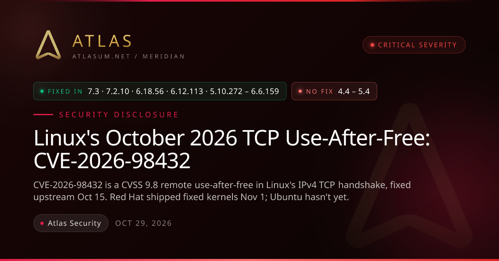

**원본 링크**: [Linux's October 2026 TCP Use-After-Free: CVE-2026-98432](https://atlasum.net/blog/cve-2026-98432-linux-ipv4-tcp-uaf){:target="_blank"}{: target="_blank"}

리눅스 커널의 IPv4 TCP 핸드셰이크에서 발생하는 CVE-2026-98432 취약점은 원격에서 인증 없이 접근 가능한 심각한 사용 후 해제(Use-After-Free) 버그로, 업스트림은 10월 15일에 수정되었으나 일부 배포판은 아직 패치를 적용하지 않았습니다. 이 취약점은 리눅스 서버가 IPv4 TCP 연결을 수락할 때 발생하는 코드에 존재하며, 인증되지 않은 공격자가 루트 권한으로 명령을 실행할 수 있는 익스플로잇이 개발된 것으로 알려졌습니다.

## 취약점 개요

* `CVE-2026-98432`[^ref6][^ref5][^ref4][^ref3][^ref2][^ref1]는 `IPv4 TCP handshake` 내의 `use-after-free` 취약점으로, **원격 비인증 공격자**가 접근 가능
* 커널 CNA는 해당 취약점을 `CVSS 3.1 9.8`로 평가하여 **Critical** 심각도 등급 부여

## 위협 및 영향

* 취약점은 모든 `Linux` 서버가 `IPv4 TCP` 연결 수락 시 실행하는 코드에 존재
* 원격, 비인증 공격자가 `root` 권한으로 **원격 코드 실행**을 유발 가능
* Anthropic[^ref12][^ref11]의 Claude 모델이 멀티패스 `TCP` 리스너 서버에 대한 **작동 가능한 PoC 익스플로잇** 작성
* 공격 시 `kernel heap contents`가 원격 피어에게 노출될 수 있으며, 커널 메모리 손상 또는 충돌 발생 가능

## 영향 범위

* 패치가 없는 `4.4` 버전부터의 **모든 Linux 커널**에 취약점 노출
* 호스트 커널을 사용하므로 **컨테이너 환경** 또한 영향을 받는 범위에 포함
* 주요 취약점은 `IPv6` 연결에 **영향을 미치지 않음**

## 공식 패치 일정

* 상위 커널에서 `2026년 10월 11일` 및 `10월 15일`에 **패치 배포** 진행
* 패치된 커널 버전은 `7.2.10`, `6.18.56` 등 다수 존재
* 최신 커널 `7.3`은 `2026년 10월 18일`에 **패치 적용** 완료

## 배포판 패치 현황

* `Red Hat`[^ref8]은 `2026년 11월 1일`에 `RHEL 8`, `9`, `10`에 **패치 완료**
* `Ubuntu`[^ref9]는 `2026년 11월 1일` 기준 **모든 릴리스에서 취약** 상태 유지
* `AlmaLinux`[^ref10][^ref7]의 패치된 커널은 **현재 테스트 진행 중**

## 발견 및 기록

* Anthropic 소속 `Xinyang Ge`에 의한 취약점 **보고**
* `cve.org`에 `2026년 10월 15일` **공개**
* Red Hat, `10월 30일`에 중요(`8.1`)에서 **Critical(`9.8`)**로 등급 상향 조정

## 마치며

리눅스 커널의 IPv4 TCP 핸드셰이크에서 발생하는 CVE-2026-98432 취약점은 원격에서 인증 없이 공격이 가능한 심각한 사용 후 해제(Use-After-Free) 버그입니다. 해당 취약점은 리눅스 업스트림에서 10월 15일 수정되었으나, 주요 배포판별 적용 시점에 차이가 있습니다. 레드햇은 11월 1일 패치된 커널을 배포했으나, 현재까지 우분투의 추적기에는 해당 취약점이 여전히 존재하는 것으로 나타나고 있습니다. 이 취약점은 공격자가 루트 권한으로 명령을 실행할 수 있는 가능성을 내포하고 있어 즉각적인 보안 조치가 요구됩니다.

## Quick questions

> **CVE-2026-98432 취약점이 무엇이며, 어떤 심각도를 가지나요?**
>
> 이 취약점은 리눅스 커널의 IPv4 TCP 핸드셰이크 과정에서 발생하는 사용 후 해제(Use-After-Free) 문제입니다. 커널 자체 평가(CNA)에 따르면 CVSS 3.1 점수는 9.8로 'Critical(치명적)' 등급을 받았습니다.
{: .prompt-info}

> **이 취약점의 위험성이 높은 주된 이유는 무엇이며, 공격자가 어떤 행위를 할 수 있나요?**
>
> 이 버그는 모든 리눅스 서버가 IPv4 TCP 연결을 수락할 때 실행되는 코드에 존재하기 때문에 위험합니다. 공격자는 인증 없이 원격으로 이 취약점을 이용해 루트 권한으로 명령을 실행할 수 있는 개념 증명(PoC)을 개발한 바 있습니다.
{: .prompt-info}

> 이 포스트는 블로그 주인장이 흥미롭다고 생각하는 주제를 AI를 통해 요약한 글입니다.  주인장이 개인적으로 읽으려고 만든게 맞으니 참고 바랍니다!
{: .prompt-tip}

---

[^ref1]: [Trevor Fannin@trvrioFounder, AtlasSecurity alerts and CVE breakdowns, plus infrastructure and general tech.Followon X (opens in a new tab)](https://x.com/trvrio){:target="_blank"}
[^ref2]: [CVE-2026-98432](https://www.cve.org/CVERecord?id=CVE-2026-98432){:target="_blank"}
[^ref3]: [CVE page](https://access.redhat.com/security/cve/CVE-2026-98432){:target="_blank"}
[^ref4]: [CVE page](https://www.suse.com/security/cve/CVE-2026-98432/){:target="_blank"}
[^ref5]: [CVE page](https://linux.oracle.com/cve/CVE-2026-98432.html){:target="_blank"}
[^ref6]: [CVE page](https://explore.alas.aws.amazon.com/CVE-2026-98432.html){:target="_blank"}
[^ref7]: [AlmaLinux](https://almalinux.org/blog/2026-10-30-cve-2026-98432/){:target="_blank"}
[^ref8]: [Red Hat RHSB-2026-016](https://access.redhat.com/security/vulnerabilities/RHSB-2026-016){:target="_blank"}
[^ref9]: [Ubuntu](https://ubuntu.com/security/CVE-2026-98432){:target="_blank"}
[^ref10]: [AlmaLinux errata](https://errata.almalinux.org/){:target="_blank"}
[^ref11]: [Anthropic: Discovering and exploiting vulnerabilities in critical, real-world software with Claude](https://www.anthropic.com/research/discovering-vulnerabilities-with-claude){:target="_blank"}
[^ref12]: [Anthropic's coordinated vulnerability disclosure policy](https://www.anthropic.com/coordinated-vulnerability-disclosure){:target="_blank"}
